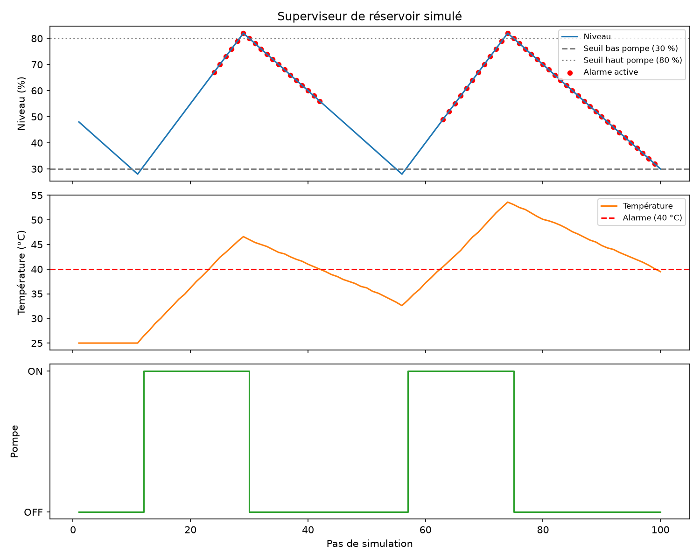
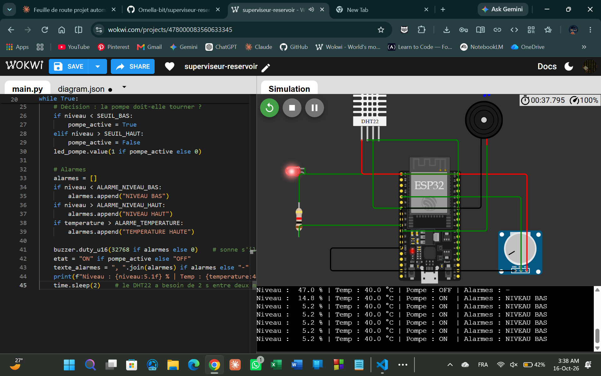

# Superviseur de réservoir simulé

Simulation d'un réservoir avec pompe, capteurs de niveau et de température, et alarmes. Les mesures sont enregistrées dans un fichier CSV puis tracées en graphiques.

## Fonctionnement
- La pompe démarre quand le niveau passe sous 30 % et s'arrête au-dessus de 80 % (deux seuils pour éviter les allumages et arrêts répétés).
- La température monte quand la pompe tourne et redescend quand elle est arrêtée.
- Alarmes : niveau bas (< 15 %), niveau haut (> 95 %), température haute (> 40 °C), pompe inefficace (pompe ON mais niveau qui baisse).

## Lancer le projet
1. Installer les dépendances : `pip install pandas matplotlib`
2. Lancer la simulation : `python simulation.py` (génère `donnees.csv`)
3. Tracer les graphiques : `python graphiques.py` (génère `graphiques.png`)

## Outils
Python, pandas, matplotlib, Git et GitHub.

## Version ESP32 (Wokwi)
La même logique tourne sur un ESP32 simulé avec MicroPython : un potentiomètre simule le niveau, un capteur DHT22 mesure la température, une LED représente la pompe et un buzzer signale les alarmes.

- Code : [`wokwi/main.py`](wokwi/main.py)
- Simulation en ligne : https://wokwi.com/projects/478000083560633345
- 